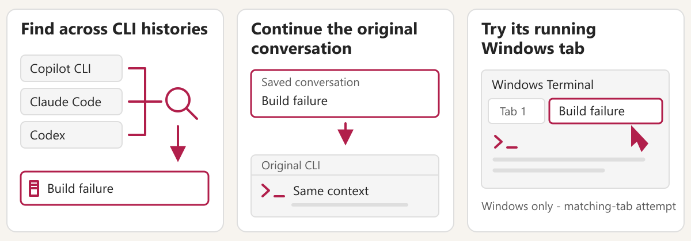

# Agent CLI Session TUI — Rechercher dans l’historique et reprendre les sessions

<a id="languages"></a>
<details>
<summary>Languages (16)</summary>

[English](../../README.md) · [简体中文](README.zh-CN.md) · [繁體中文](README.zh-TW.md) · [日本語](README.ja.md) · [한국어](README.ko.md) · [Español](README.es.md) · [Português (Brasil)](README.pt-BR.md) · [Français](README.fr.md)

[Deutsch](README.de.md) · [Italiano](README.it.md) · [Русский](README.ru.md) · [Türkçe](README.tr.md) · [Tiếng Việt](README.vi.md) · [Bahasa Indonesia](README.id.md) · [हिन्दी](README.hi.md) · [العربية](README.ar.md)

</details>

Vous vous souvenez du travail, mais pas du CLI qui contient la conversation ? Cherchez dans les historiques de Copilot CLI, Claude Code, Codex CLI, Qwen CLI, Gemini CLI et Kimi. Si vous connaissez déjà le fournisseur et la session, son historique natif peut suffire.



Illustration conceptuelle, pas une capture réelle de l’application. Libellés anglais et lignes fictives.

- **Retrouvez votre travail :** une recherche dans plusieurs historiques conservés, même pour les conversations lancées hors de ce TUI.
- **Reprenez la conversation originale :** rouvrez son contexte enregistré via le CLI original installé.
- **Retrouvez son onglet actif sous Windows :** tentez de sélectionner l’onglet correspondant de Windows Terminal ; sous Linux/macOS, basculez manuellement.

<a id="install-core"></a>

## Première recherche privée : Core + wordmatch

Il faut un historique enregistré, un CLI installé et authentifié, accessible par le `command` configuré, et le répertoire d’origine disponible. Utilisez un terminal interactif et une version pour votre système/processeur. Lanceurs par défaut : Windows `wt` (repli `cmd`), Linux `gnome-terminal`, macOS `osascript` avec Terminal. Sinon, adaptez la [configuration](../usage.md#configuration).

**Avant le lancement :** le regroupement distant par défaut peut envoyer automatiquement **titres et répertoires de travail** à un service hébergé après la découverte de l’historique. Il n’existe pas de contrat public d’API pour les tiers. Core + `wordmatch` évite ce regroupement distant, pas les connexions des CLI eux-mêmes. Le plugin sémantique facultatif peut télécharger des modèles à l’initialisation ; commencez avec Core sans ce plugin.

1. Dans [Archives Core par système et processeur](../usage.md#core-archive-filenames), prenez l’**archive Core complète** pour votre système/processeur, pas l’archive du code source. Extrayez tout et gardez ensemble le binaire, `providers/`, `prompts/` et le `config.toml.example` généré. [Vérifiez l’empreinte du fichier exact](../usage.md#verify-a-release-download) ; la concordance n’est ni signature ni garantie de sécurité. Respectez alertes du système et règles de l’organisation.
2. Pour une installation neuve, copiez l’exemple généré en `config.toml` près du binaire. **N’écrasez pas les réglages existants et ne renommez pas le `config.toml.template` source.** Dans la copie, retirez le `#` initial des **deux lignes**, `# [grouping]` et `# engine = "remote"`, puis changez la valeur :

```toml
[grouping]
engine = "wordmatch"
```

Laissez les autres options commentées. Si une table `[grouping]` active existe déjà, modifiez son `engine` sans la dupliquer. Vérifiez `state_dir` et `command` ; **enregistrez avant le lancement**. `wordmatch` compare les mots communs ; ce n’est pas une IA locale.

3. Lancez depuis un terminal dans le dossier extrait :

```powershell
# Windows PowerShell
.\agent-session-tui.exe
```

```sh
# Linux/macOS
./agent-session-tui
```

<a id="first-workflow"></a>

## Première recherche et résultat attendu

4. Attendez la liste, appuyez sur `/` et saisissez un fragment littéral du titre ou du projet de votre historique. Avec `↑`/`↓`, vérifiez fournisseur, titre et répertoire ; choisissez **Resumable**, puis `Enter`. **Résultat attendu :** le CLI original ouvre la conversation choisie pour la poursuivre. La recherche peut manquer des résultats ; les versions des CLI natifs testées sont inconnues. [Couverture et preuves](../usage.md#supported-providers).

<a id="windows-terminal"></a>

Pour **Running/Waiting/Idle**, Windows seul tente de sélectionner un onglet correspondant ; ce n’est pas un rattachement universel aux processus. Répéter rapidement `Enter` sur la même session active peut **forcer sa reprise** plutôt que changer d’onglet. Vérifiez d’abord. [Parcours Windows](../usage.md#secondary-workflow-find-a-running-windows-tab).

**Aucun résultat ?** Vérifiez historique conservé, fournisseur activé et `state_dir` ; si le lancement échoue, contrôlez authentification, répertoire d’origine et lanceur. [Dépannage](../usage.md#troubleshooting-update-and-removal).

**Quitter :** `Esc` annule la recherche ; ensuite, `q` quitte le TUI, ou utilisez `Ctrl+C` dans la liste ou la recherche sans effacer les historiques ni arrêter les autres CLI. L’arrêt des sessions n’est pas implémenté. [Mise à jour, restauration et suppression](../usage.md#troubleshooting-update-and-removal).

Le [guide d’utilisation et de preuves en anglais](../usage.md) conserve chiffres complets, résultats défavorables et limites. La version et la date de l’[enregistrement](../usage.md#recorded-demo) sont inconnues ; il ne prouve pas la compatibilité actuelle.
