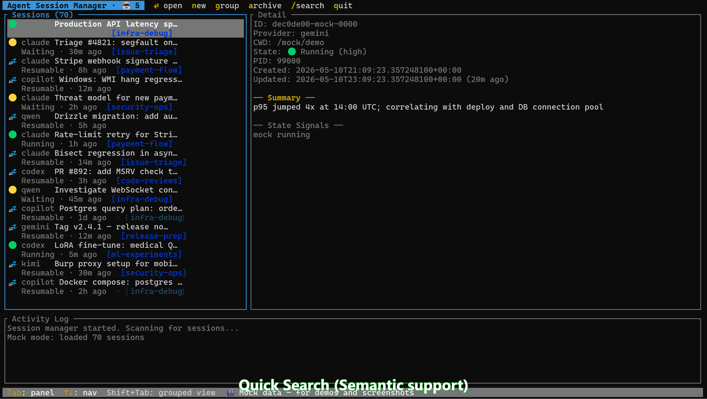

# Agent CLI Session TUI — Cercare nella cronologia e riprendere le conversazioni

<a id="languages"></a>
<details>
<summary>Languages / 语言 / 言語 / اللغات (16)</summary>

[English](../../README.md) · [简体中文](README.zh-CN.md) · [繁體中文](README.zh-TW.md) · [日本語](README.ja.md) · [한국어](README.ko.md) · [Español](README.es.md) · [Português (Brasil)](README.pt-BR.md) · [Français](README.fr.md)

[Deutsch](README.de.md) · [Italiano](README.it.md) · [Русский](README.ru.md) · [Türkçe](README.tr.md) · [Tiếng Việt](README.vi.md) · [Bahasa Indonesia](README.id.md) · [हिन्दी](README.hi.md) · [العربية](README.ar.md)

</details>

Cerca nelle cronologie di più CLI. Riprendi la conversazione con il suo contesto nel CLI originale installato. Solo su Windows, prova a selezionare la scheda Windows Terminal corrispondente già in esecuzione, senza aprire un’altra finestra.

[Vedi il percorso](#first-workflow) · [Installa Core](#install-core) · [Fornitori e limiti](../../README.md#supported-providers)

Il raggruppamento remoto predefinito può inviare automaticamente titoli e percorsi; scegli Core + wordmatch prima dell’avvio.


Illustrazione concettuale, non una schermata reale dell’app. Le etichette inglesi e le righe fittizie sono esempi, non cronologie private reali.

- Ritrova un argomento o progetto: cerca una frase che ricordi e verifica fornitore, titolo e directory.
- Riprendi la conversazione giusta: `Enter` su **Resumable** richiede cronologia conservata, CLI installato e autenticato e directory originale accessibile.
- Ritrova la scheda in esecuzione su Windows: tenta di selezionare una scheda corrispondente di Windows Terminal, solo su Windows; non è un collegamento universale ai processi. Su Linux/macOS passa manualmente al terminale.

Non deve essere stata avviata da questo TUI.


<a id="install-core"></a>

## Prima ricerca privata: Core + wordmatch

Serve una conversazione salvata da almeno un fornitore. Per riprenderla, il suo CLI deve essere installato, autenticato e raggiungibile tramite il `command` configurato; la directory di lavoro originale deve essere accessibile. Usa un terminale interattivo e una versione adatta al sistema e alla CPU.

Lanciatori predefiniti: Windows `wt` (alternativa `cmd`), Linux `gnome-terminal`, macOS `osascript` con Terminal. Adatta la configurazione se mancano. Core ha destinazioni x64/arm64 per i tre sistemi; i pacchetti semantici non coprono tutte le destinazioni, verifica gli allegati della release. La selezione nativa delle schede richiede Windows Terminal ed è solo per Windows.

Da [Releases](https://github.com/yeelam-gordon/agent-cli-session-TUI/releases) scarica l’**archivio Core completo**, non quello del codice sorgente. Estrai tutto e mantieni insieme eseguibile, `providers/`, `prompts/` e `config.toml.example` generato. Copia l’esempio come `config.toml` accanto all’eseguibile senza sovrascrivere impostazioni esistenti. Controlla `state_dir`, `command` e il lanciatore. Il sorgente `config.toml.template` contiene segnaposto: non basta rinominarlo.

Verifica il digest del file esatto prima dell’avvio; la corrispondenza non è una firma né garanzia di sicurezza. Rispetta avvisi del sistema e politiche dell’organizzazione. [SHA-256](../../README.md#verify-a-release-download).

**Avviso prima del primo avvio:** il raggruppamento predefinito `remote` invia titoli e directory di lavoro a un servizio ospitato e può partire automaticamente dopo il rilevamento iniziale. Non esiste un contratto API pubblico per terze parti. Per raggruppare senza rete, nella copia trova `# [grouping]` e `# engine = "remote"`: togli il `#` iniziale da entrambe le righe e cambia il valore in `"wordmatch"`.

```toml
[grouping]
engine = "wordmatch"
```

Lascia commentate le altre opzioni. Se esiste già una tabella `[grouping]` attiva, modifica il suo `engine` senza aggiungerne un’altra. Salva prima di avviare o leggere la cronologia. `wordmatch` confronta parole, non è IA locale e non controlla le connessioni dei CLI. Il plugin semantico facoltativo può scaricare modelli all’inizializzazione; parti con Core per non caricarlo.

<a id="first-workflow"></a>

## Prima ricerca e risultato atteso

Inizia con un frammento letterale del titolo o progetto. Core offre ricerca per parole e approssimativa; le parafrasi semantiche richiedono il plugin facoltativo.

Dal terminale nella cartella estratta, su Windows PowerShell:

```powershell
.\agent-session-tui.exe
```

Su Linux/macOS:

```sh
./agent-session-tui
```

Sono incluse sei definizioni di cronologia e percorsi di ripresa configurati; le versioni dei CLI nativi testate qui sono **sconosciute**. Non è una certificazione di compatibilità in uso reale. Vedi [copertura e prove](../../README.md#supported-providers).

| UI | `Enter` |
|---|---|
| Resumable (conversazione riprendibile) | Riprendere con CLI installato e autenticato e directory originale accessibile |
| Running / Waiting / Idle | Solo su Windows tentare di selezionare la scheda in esecuzione corrispondente di Windows Terminal; altrimenti passare manualmente |
| Archived / Stopped | Riprendere con CLI installato e autenticato e directory originale accessibile; [limiti](../../README.md#supported-providers) |


Attendi l’elenco, premi `/` e inserisci un progetto o una frase della tua cronologia. Con `↑`/`↓` controlla i dettagli: fornitore, titolo e directory, poi `Enter`. Con **Resumable**, ci si aspetta un terminale in cui il CLI carica la conversazione scelta per continuarla.

`Esc` annulla la ricerca; `q` / `Ctrl+C` esce senza cancellare la cronologia né fermare altri CLI. La terminazione delle sessioni non è implementata.

- Elenco vuoto: verifica cronologia salvata, fornitore abilitato e `state_dir`.
- Ripresa fallita: verifica installazione del CLI, autenticazione e directory originale.
- Avvio fallito: estrai l’archivio completo con `providers/`, `prompts/` ed esempio generato; verifica il lanciatore.

Elenco vuoto, configurazione errata, problemi di avvio o selezione, aggiornamento, rimozione e ripristino: [risoluzione dei problemi in inglese](../../README.md#troubleshooting-update-and-removal). Il [manuale inglese](../../README.md) è il riferimento tecnico; vedi [configurazione](../../README.md#configuration) e [dati inviati](../../README.md#what-remote-sends).


Se conosci già fornitore e sessione, basta la cronologia del CLI. Questo catalogo aiuta con più CLI o progetti, quando ricordi l’argomento ma non l’ID.

Un gestore di sessioni di terminale per le conversazioni conservate di Copilot CLI, Claude Code, Codex CLI, Qwen CLI, Gemini CLI e Kimi, anche avviate separatamente. Sono sei fornitori integrati: la copertura dipende dai formati e dai filtri di rilevamento, non include automaticamente ogni CLI.

Segui i passi sulla privacy prima dell’avvio; il raggruppamento remoto predefinito può partire automaticamente.


### Windows Terminal

Con **Running/Waiting/Idle**, solo su Windows si tenta di selezionare una scheda corrispondente di Windows Terminal: se riesce, la scheda è selezionata e la finestra va in primo piano. Su Linux/macOS passa manualmente al terminale attivo. Risultati e corrispondenze approssimative non sono garantiti.

<details>
<summary>↳ Prima ricerca privata: Core + wordmatch</summary>

**Esempio fittizio, non osservato in esecuzione né incluso come sessione:** premi `/`, cerca `build failure` e immagina una riga Claude Code · titolo `Build failure` · progetto `demo-project`. Con `↑`/`↓`, verifica fornitore, titolo e directory originale. Se è la conversazione **Resumable** giusta, `Enter` la riapre tramite il CLI Claude installato e autenticato, con la directory accessibile. Nessuna garanzia di risultati o compatibilità.

</details>


Consulta le conversazioni conservate, cerca nella tua cronologia e scegline una da riprendere. Il GIF mostra l’interfaccia inglese della versione registrata, non verifica la versione attuale o la compatibilità di ogni CLI. Tradurre i documenti non traduce l’interfaccia né le conversazioni salvate. Imposta la privacy descritta nei passi di installazione prima di avviare il programma. La versione e la data della registrazione sono sconosciute. [Installa Core](#install-core).


